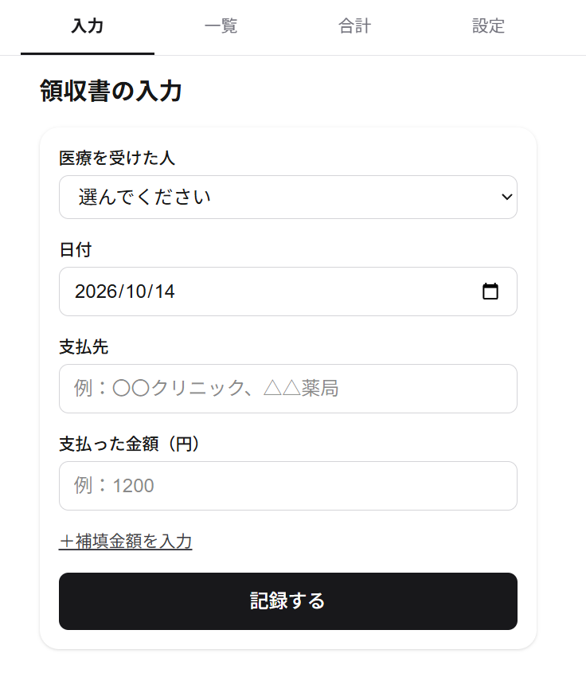
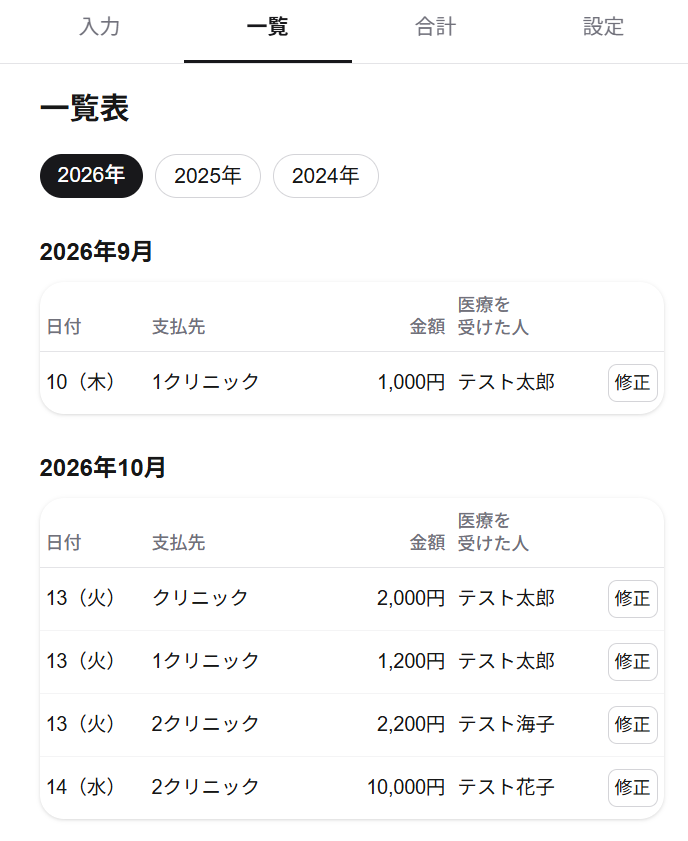
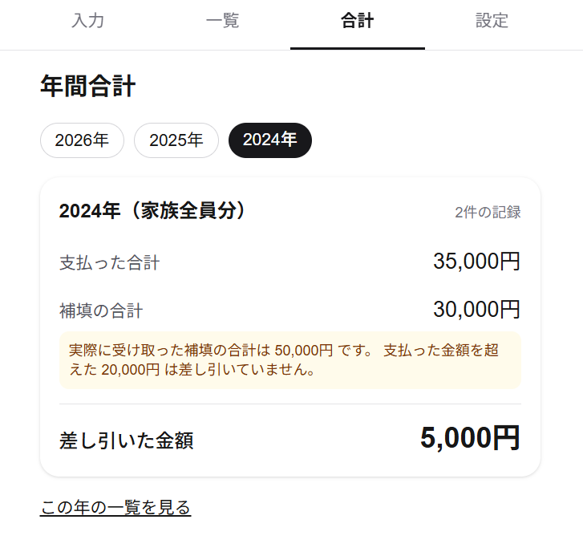
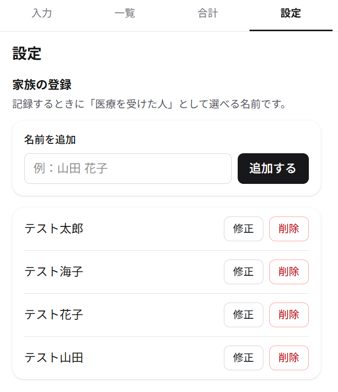

# 医療費記録アプリ

家族の医療費を、スマホでその都度記録しておくためのアプリです。
確定申告のときに、領収書を1枚ずつ足し算しなくても、1年分の医療費の合計をすぐに確認できます。

**公開URL：https://iryouhi-kiroku-app.vercel.app**
（Google アカウントでログインして使います。記録はログインした本人にしか見えません）

## どんな人の、どんな困りごとを解決するか

- **対象**：家族の医療費をまとめて確定申告する人
- **困りごと**：
  - 医療費の領収書を1年分ためておき、確定申告の前にまとめて足し算するのが大変
  - 領収書を失くしたり、どこで払ったか忘れたりする
- **解決のしかた**：
  - 病院や薬局で支払ったら、その場でスマホから記録する
  - 確定申告のときは、年間合計の画面を見れば、医療費の欄に書く金額がわかる

## スクリーンショット

画面はすべて架空のデータです。

<table>
  <tr>
    <td align="center" width="50%">
      <br>
      <b>入力</b><br>
      医療を受けた人・日付・支払先・金額を入れて記録します。日付は今日が最初から入っています。入院給付金などがあるときは「＋補填金額を入力」から入れます
    </td>
    <td align="center" width="50%">
      <br>
      <b>一覧</b><br>
      記録を日付の古い順に、月ごとに区切って表示します。年を切り替えられます。各行の「修正」から、記録を直したり削除したりできます
    </td>
  </tr>
  <tr>
    <td align="center" width="50%">
      <br>
      <b>合計</b><br>
      年ごとに「支払った合計」「補填の合計」「差し引いた金額」を、家族全員分まとめて表示します。補填金額が支払った金額を超えた記録があるときは、差し引かなかった金額を注意書きで知らせます
    </td>
    <td align="center" width="50%">
      <br>
      <b>設定</b><br>
      記録のときに選ぶ「医療を受けた人」（家族の名前）を登録します。ログアウトもこの画面から行います
    </td>
  </tr>
</table>

## 主な機能（MVP）

| 機能 | 内容 |
|---|---|
| ログイン | Google アカウントでログインします。ログインしていないときは、ログイン画面を表示します |
| 医療費の記録 | 医療を受けた人・日付・支払先・金額は必須です。補填金額は任意です。空欄のまま記録しようとすると、項目ごとにメッセージを出します |
| 記録の一覧 | 日付の古い順に、月ごとに区切って表示します。年ごとに切り替えられます |
| 年間合計 | 支払った合計・補填の合計・差し引いた金額の3つを、年ごとに表示します |
| 記録の修正・削除 | 一覧の「修正」から編集画面を開きます。削除するときは「はい」「いいえ」で確認します |
| 家族の登録 | 医療を受けた人の名前を、追加・修正・削除できます。記録で使っている名前は削除できないようにしています |

詳しい要件は [requirements.md](./requirements.md) にまとめています。

## 技術スタック

| 分野 | 使ったもの |
|---|---|
| フロントエンド・サーバー | Next.js 16（App Router）、React 19、TypeScript |
| 見た目 | Tailwind CSS v4 |
| データベース・ログイン | Supabase（PostgreSQL、Google ログイン、RLS） |
| 公開 | Vercel（GitHub の `main` に push すると自動で本番に反映） |

予算は無料の範囲で作れるようにしました。Supabase も Vercel も無料プランを使っています。

## 工夫した点

### 1. 補填金額を確定申告のルールに合わせて計算する

入院給付金などは、支払った医療費より多く受け取ることがあります。確定申告のルールでは、補填金額はその医療費の分までしか差し引けません。超えた分を、ほかの医療費から差し引くこともできません。

そこで、補填金額は受け取った金額をそのまま記録し、合計を出すときに、記録1件ごとに「補填金額」と「支払った金額」の小さいほうを使うようにしました。差し引いた金額がマイナスになることはありません。

> 例：入院（支払った金額 30,000円・補填金額 50,000円）と、通院（支払った金額 5,000円・補填なし）の2件
> → 支払った合計 35,000円、補填の合計 30,000円、差し引いた金額 5,000円

実際に受け取った補填の合計と、差し引きに使った補填の合計が違うときは、年間合計の画面に注意書きを出します。

### 2. 本人以外は記録を見られないようにする

医療費は個人的な情報なので、ログインの確認を3か所で重ねています。

- ページを開く前の入口で、ログインしていない人をログイン画面に移す
- 各ページと保存処理の中で、もう一度ログインを確かめる
- データベースの設定（RLS：行ごとのアクセス制限）で、自分の行しか読み書きできないようにする

さらに、記録を保存する前に「選ばれた家族が、本当に自分の登録した家族か」も確かめています。データベースの制限だけでは、ほかの人の家族の番号を指定した保存を防げないためです。

### 3. 日付は日本時間で決める

サーバー（Vercel）は世界標準時で動いています。そのため、そのままだと日本時間の0〜9時に記録したとき、日付の初期値が前の日になってしまいます。「今日」は日本時間で決めるようにしました。未来の日付は記録できません。

### 4. 支払先の表記をそろえる

「2クリニック」と「２クリニック」が別の支払先に見えないように、保存するときに全角の英数字を半角に、半角カタカナを全角にそろえています。

まとめて変換する標準のやり方（NFKC）は使っていません。「㈱」が「(株)」に、「①」が「1」に変わるなど、領収書の表記から離れてしまうためです。

### 5. スマホで使いやすくする

- 金額の欄では数字のキーボードが出ます。全角数字やカンマ（１，２００）で入れても記録できます
- 保存中はボタンを「保存中…」にして押せなくし、二重に記録されないようにしています
- 一覧の表は、どの月でも列の位置がそろうように列の幅を固定しています。スマホ幅（約400px）でも、短い支払先と名前は1行に収まります

### 6. 公開リポジトリでも安全に

リポジトリは公開しているので、スクリーンショットやサンプルには架空のデータだけを使っています。接続情報やログインの秘密の値は、リポジトリに入れていません。

## セットアップ（自分の環境で動かす場合）

1. 依存パッケージをインストール
   ```bash
   npm install
   ```
2. Supabase でプロジェクトを作成し、「Project Settings > API」の URL と anon key を `.env.local` に入れる
   ```bash
   cp .env.example .env.local
   ```
3. Supabase の SQL Editor で [`supabase/schema.sql`](./supabase/schema.sql) を実行してテーブルと RLS を作成する
4. Google ログインを設定する
   1. Google Cloud Console で OAuth 同意画面（外部）と、OAuth クライアント ID（ウェブ アプリケーション）を作成する
   2. 承認済みのリダイレクト URI に `https://<プロジェクトID>.supabase.co/auth/v1/callback` を追加する
   3. Supabase の「Authentication > Sign In / Providers > Google」を有効にし、クライアント ID とシークレットを入れる（シークレットは Supabase にだけ入れ、リポジトリには置かない）
   4. Supabase の「Authentication > URL Configuration」で、Site URL に本番の URL を、Redirect URLs に次の2つを入れる
      - `http://localhost:3000/auth/callback`
      - `https://<本番のドメイン>/auth/callback`
5. 開発サーバーを起動
   ```bash
   npm run dev
   ```
   [http://localhost:3000](http://localhost:3000) で確認できる。
6. Vercel に GitHub リポジトリをつなぎ、環境変数 `NEXT_PUBLIC_SUPABASE_URL` と `NEXT_PUBLIC_SUPABASE_ANON_KEY` を登録する。以後は `main` に push すると本番に反映される

Supabase の無料プランは、しばらく使わないと一時停止する。止まったら Supabase の管理画面で再開する。

## ディレクトリ構成（抜粋）

```
src/app/(app)/        ログイン後の画面（入力・一覧・合計・設定・編集）と共通メニュー
src/app/_expenses/    記録のフォーム・入力チェック・保存処理（入力画面と編集画面で共通）
src/app/login/        ログイン画面
src/lib/              日付・金額の表示、合計の計算、文字の変換など
src/lib/supabase/     Supabase クライアントとログイン確認
supabase/schema.sql   テーブル定義・RLS
screenshots/          README 用のスクリーンショット（架空のデータ）
```
